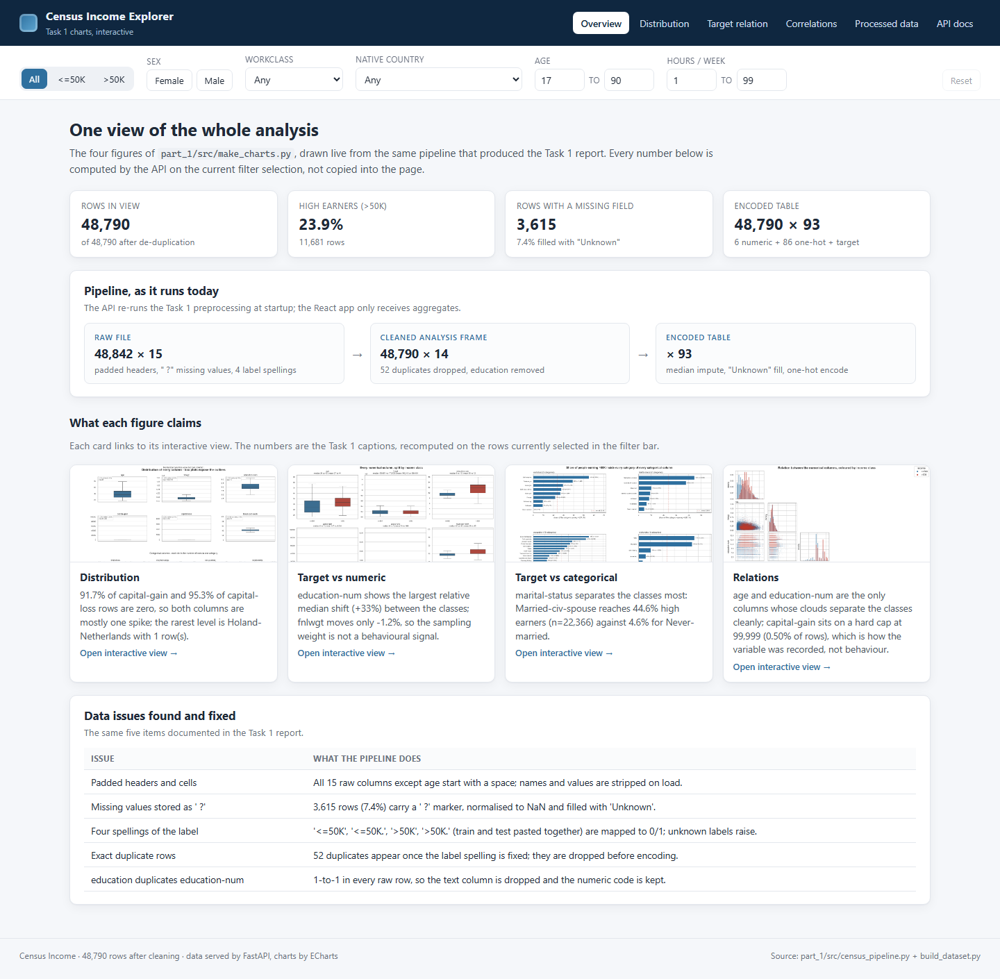
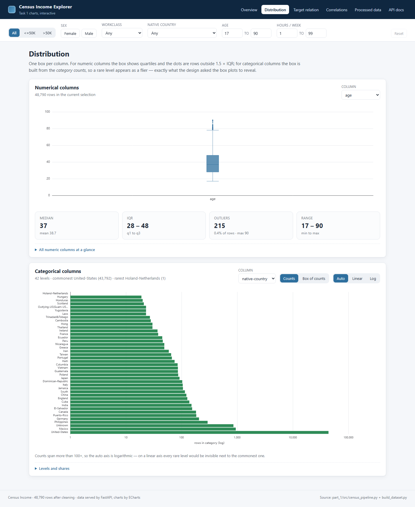
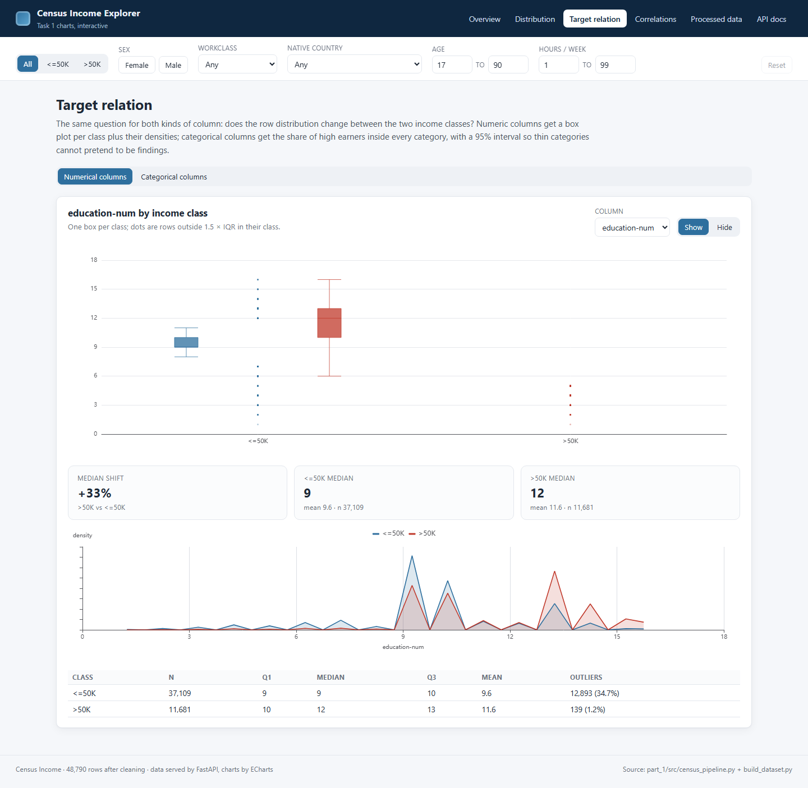
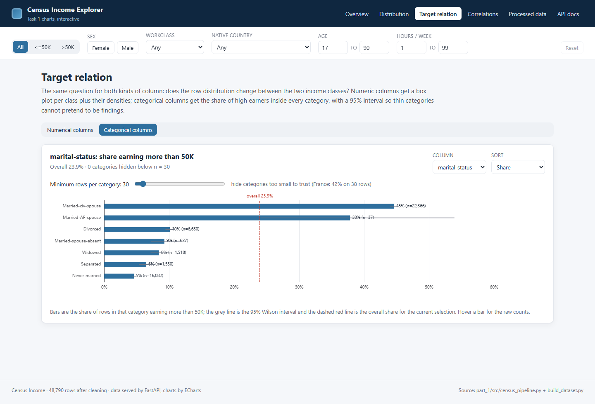
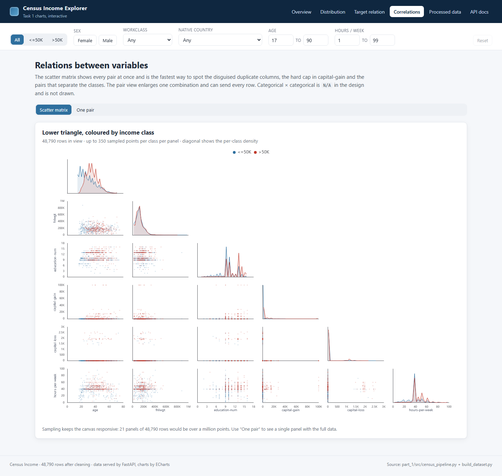
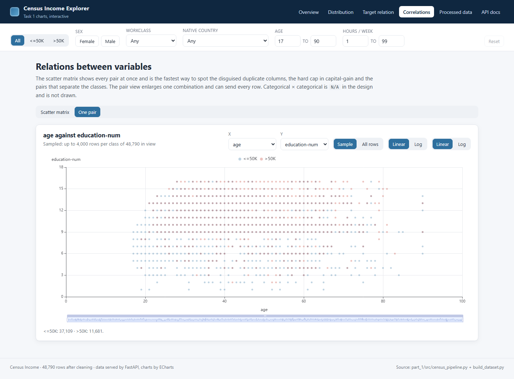
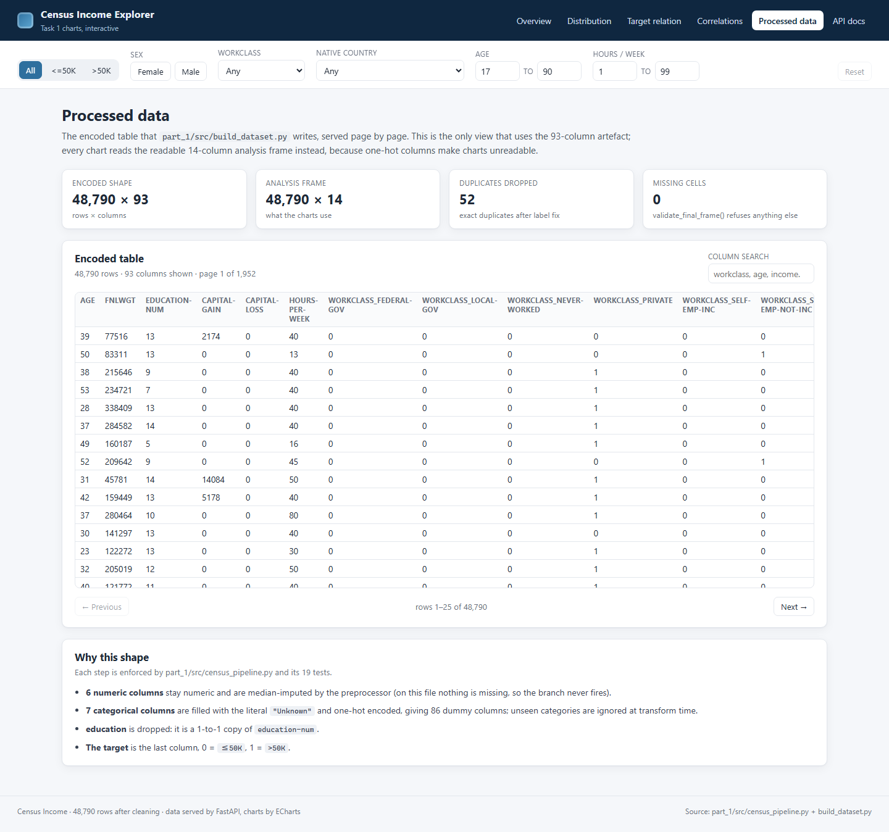

# Task 2 report: App deployment

| Field | Value |
| --- | --- |
| Student | Alessandro Jacopo Ravizza |
| Dataset | Census Income (`part_1/data/raw_data/census_income.csv`) |
| Task | 2 |
| Tag / commit | `task2` |
| How to run | `cp datasets/census_income.csv part_1/data/raw_data/`, then `cd part_2/deploy && docker compose up -d --build`; open <http://localhost:8080> |
| Timebox | 2:30-3:00, finished |

## 1. Summary

I turned the four static figures of Task 1 into a React + ECharts app that
computes every number on demand, with six shared filters carried in the URL.
A FastAPI service reads the same preprocessing pipeline at startup and answers
one aggregate per chart, from 0.9 KB to 105 KB of JSON; a cached request takes
about 2 ms and the 48,790 x 14 frame loads in 0.62 s, so I did not add a
database. `docker compose up` starts a one-shot pipeline job, then the API,
then nginx serving the bundle and proxying `/api`, all on one origin. The stack
is 751 MB across two images, the whole thing starts in under a minute on a
laptop, and 41 pytest, 13 Vitest and 7 Playwright checks cover the pipeline,
the aggregates, the filter round trip and every view. The main limitation is
that filters are not server-side authenticated or rate-limited: it is a demo
service, not a public one.

**Evidence:** `part_2/README.md`; `docker compose ps` shows all three services;
`part_2/reports/screenshots/01-overview.png`.

## 2. Goal and success criteria

**Goal.** Deploy an interactive version of the Task 1 analysis: the user picks
filters, every chart updates, and the deployment is reproducible from a fresh
clone with one command - without duplicating the preprocessing logic.

| Criterion | How it is measured | Target | Result |
| --- | --- | --- | --- |
| All four Task 1 figures are interactive | one route per figure, checked in screenshots | 4/4 figures, plus a data view | 5 routes, 7 captured states |
| Filters apply to every view | one query-parameter set, asserted by API tests | every endpoint honours them | 8 filters on all chart endpoints |
| Numbers agree with Task 1 | pytest asserts the report values | exact match | 44.61% married-civ-spouse, 13,486 outliers, 48,790 rows |
| Reproducible deployment | fresh `docker compose up -d --build` | one command, no manual step | pipeline exit 0, api healthy, web healthy |
| No data committed | `git status` after a clean clone | raw and processed files ignored | `.gitignore` still excludes both |
| Automated checks | pytest / Vitest / Playwright | all green | 41 + 13 + 7, no console errors |

**Evidence:** `part_2/api/tests/`, `part_2/app/src/test/`, `npm run screenshots`
output; `docker compose ps` in section 4.

## 3. Approach and key decisions

| # | Finding | Decision | Alternative considered | Where in the code |
| --- | --- | --- | --- | --- |
| D1 | The charts need 48,790 rows and four figures, but the browser only needs summaries | Serve aggregates from FastAPI; the client never receives raw rows for a chart | Send the CSV and compute in the browser (58 MB parse, duplicate logic) | `api/aggregates.py` |
| D2 | The analysis frame loads in 0.62 s and a cached aggregate answers in ~2 ms | Keep both frames in memory, no database | PostgreSQL + a schema + a query layer, which adds a hop without removing a bottleneck | `api/app.py` (`State`) |
| D3 | Two requests with the same selection must return the same numbers | One `Filters` dataclass whose tuple is the cache key and the mask | Per-endpoint filter parsing, which drifts between charts | `api/filters.py` |
| D4 | A view must be shareable and survive a reload | URL search params are the single source of truth; no Redux | React state + localStorage (not bookmarkable) | `app/src/hooks/useFilters.ts` |
| D5 | Task 1 already encodes the data; rewriting the transform in JS would drift | The API re-uses `census_pipeline.load_analysis_frame` and `build_dataset.py` | A second implementation in TypeScript | `api/app.py`, `deploy/build_artifacts.sh` |
| D6 | 21 scatter panels of full data would be ~1M points | Stratified sampling per class per panel, exact counts elsewhere | Draw everything and freeze the tab | `aggregates.relation_matrix` |
| D7 | The full ECharts entry point is 1,447 kB | Import `echarts/core` and register only the six series and six components used | Keep the full bundle and accept 474 kB gzip | `app/src/components/Chart.tsx` |
| D8 | A fresh named volume is root-owned, so a non-root job cannot write the artefact | The job starts as root only to `chown`, then `setpriv` drops to uid 10001 | Run everything as root (works, but the API should not) | `deploy/build_artifacts.sh` |
| D9 | The browser must talk to one origin, in dev and in production | Vite proxy in development, nginx `proxy_pass` in production; CORS only for the dev server | Two exposed ports + CORS in production | `deploy/nginx.conf`, `vite.config.ts` |
| D10 | `pytest`, `seaborn` and `httpx` are only needed to develop | Move them to `[dependency-groups] dev`; the image installs `--no-dev` | One image with test tools inside | `pyproject.toml`, `Dockerfile.api` |
| D11 | The task lists figures but shows a dashboard sketch | Overview page recomputes the four claims on the current selection instead of hard-coding them | Copy the Task 1 captions into JSX (they would go stale) | `aggregates.highlights` |

```
raw CSV --(pipeline, one-shot)--> artifacts volume --(read-only)--> api:8000
                                                                      |
                                                              /api/* proxy
                                                                      v
                                          browser <-- nginx:8080 + static bundle
```

**Evidence:** `part_2/deploy/compose.yaml`, `part_2/api/aggregates.py`,
`part_2/app/src/components/Chart.tsx`; `git log --oneline` for the three commits.

## 4. Results

| Result | Value | Baseline or reference |
| --- | --- | --- |
| API image | 673 MB | 828 MB before dev dependencies were separated (-19%) |
| API Python environment | 368 MB, 52 packages | 480 MB, 89 packages |
| Web image | 77.6 MB | `node:22-alpine` build stage discarded |
| Startup in the container | 0.62 s to load 48,790 rows | local run 0.45-0.69 s |
| Cached aggregate | ~2 ms per request | uncached `/api/meta` audit 24 ms |
| Largest chart payload | 105.5 KB (scatter matrix) | 48,790 raw rows would be ~5.7 MB |
| Front-end bundle | 952 kB / 312 kB gzip | 1,447 kB / 474 kB with the full ECharts entry |
| Tests | 41 pytest, 13 Vitest, 7 Playwright views | Task 1 had 19 pytest |
| Numbers preserved | 48,790 rows, 23.94% >50K, 44.61% married-civ-spouse, 13,486 hours outliers | `reports/task1.md` |



**Figure 1.** The Overview recomputes 48,790 rows in view and 23.9% high
earners from the API on the current filter selection; the four cards link to
the interactive version of each Task 1 figure.



**Figure 2.** Figure 1 interactively: the `native-country` panel spans
43,782 rows down to 1, so the auto axis is logarithmic and the rare level is
still visible.



**Figure 3.** Figure 2 interactively: `education-num` keeps its 9 vs 12 year
medians (+33%) and the density plot behind the boxes.



**Figure 4.** Figure 3 interactively: bars are the share above 50K with a 95%
Wilson interval; the slider hides categories below n = 30, which removes the
France-style 42.1% on 38 rows.



**Figure 5.** Figure 4 interactively: 21 panels in one canvas, up to 350 sampled
points per class per panel, the diagonal replaced by per-class densities.



**Figure 6.** The pair view sends up to 4,000 rows per class, or all 48,790 on
request, and exposes the 99,999 cap on `capital-gain` directly.



**Figure 7.** `/data` pages the encoded 48,790 x 93 artefact, with column search
- the only view that needs the wide table.

**Evidence:** `part_2/reports/screenshots/`; `docker images`; the timing and
payload measurements printed in this section; `uv run pytest` / `npm run test`.

## 5. Problems and how you handled them

| Problem | Cause | What I did | Status |
| --- | --- | --- | --- |
| Pipeline exited 1 with `PermissionError` on `/data/artifacts` | Docker creates a fresh named volume owned by root, but the job and API run as uid 10001 | Start the job as root, `chown` the volume, `setpriv` back to 10001 before any work | Solved |
| `docker compose build api` printed "No services to build" | `api` reuses the `pipeline` image and has no `build:` key | Build `pipeline` (or `up --build`) and documented it | Solved |
| The activity toggle looked inactive | `.toggle-group .toggle` overrode the background of `.toggle.active` | Added the explicit `.toggle-group .toggle.active` rule | Solved |
| `capital-gain` points vanished on a log axis | Log axes cannot place zeros, and 91.7% of rows are zero | Keep the linear default and warn in the note when log is on | Workaround |
| Playwright waited 15 s for text that only appears after a click | The readiness selector was checked before the action ran | Wait for the numeric page first, then click and wait for the categorical heading | Solved |
| Vitest reported "found multiple elements" in an unrelated test | Vitest globals are off, so Testing Library never cleaned the DOM between tests | Registered `afterEach(cleanup)` in `src/test/setup.ts` | Solved |
| The API image stayed at 828 MB after moving dev dependencies | The old image was still in use and `api` is not a build target | Rebuilt `pipeline`, which dropped the venv to 368 MB | Solved |

**Evidence:** `part_2/deploy/build_artifacts.sh`, `part_2/app/src/index.css`,
`part_2/app/src/test/setup.ts`; the compose build log.

## 6. Limitations and trade-offs

| Area | Limitation or trade-off | Impact | Mitigation or next step |
| --- | --- | --- | --- |
| app | No database, so nothing survives a restart except the artefact volume | Fine for a demo; not a multi-user service | Add Postgres + a materialised view only if the frame stops fitting in memory |
| app | Aggregates cache is an unbounded dict, cleared past 128 entries | A hostile client can force recomputation | Add a TTL cache and a request limit if it is ever exposed |
| app | Sampling hides individual rows in the matrix and scatter views | Rare combinations can be invisible | Keep the "All rows" toggle; show the sample size next to the chart |
| app | Filters are plain query parameters, with no auth or rate limit | Anyone who reaches port 8080 can filter and read aggregate data | Bind to localhost, or add an API gateway before exposing it |
| data | The API recomputes the analysis frame from the raw CSV at every start | 0.6 s startup, no pre-built cache | Acceptable now; the artefact is already built for the wide table |
| operations | One compose host, no orchestrator, no rolling update | Downtime while rebuilding the web image | Kubernetes manifests or a managed container service in Task 4 |
| operations | API image is 673 MB, mostly pandas and scikit-learn | Slow first pull | Multi-stage already applied; a slim base or a lock-only runtime would cut more |
| front end | 312 kB gzip is still a large single chunk | First paint waits for ECharts | Route-level `import()` for the correlation views |

**Evidence:** `part_2/api/app.py` (cache bounds), `part_2/app/scripts/screenshots.mjs`
(sample sizes), `docker images`.

## 7. Next steps

| Priority | Next step | Why | Effort |
| --- | --- | --- | --- |
| 1 | Add an automated compose smoke test in CI | The current check is manual or a local Playwright run | S |
| 2 | Split the bundle per route | The 312 kB gzip chunk delays the first chart | S |
| 3 | Add a keyed TTL cache and request limits | Makes the in-memory design safe if exposed | M |
| 4 | Move to a container orchestrator with health-gated rollout | Task 4 asks for a production view | L |
| 5 | Reuse the API as the data source for the Task 3 agent tools | One source of truth for the dataset | M |

**Evidence:** section 6; `part_2/deploy/compose.yaml`.

## 8. Use of AI assistants

| Tool | What you used it for | Where (files or sections) | How you checked the output |
| --- | --- | --- | --- |
| OpenCode agent (DeepSeek V4.1 Flash) | Draft the FastAPI endpoints and the pandas aggregates | `part_2/api/` | 22 pytest tests pinned to the Task 1 numbers; ran every endpoint |
| OpenCode agent | Scaffold the React + ECharts front end | `part_2/app/src/` | `npm run build`, 13 Vitest tests, 7 screenshots reviewed one by one |
| OpenCode agent | Dockerfile and compose structure, plus the volume permission error | `part_2/deploy/` | Rebuilt from scratch, checked health, sizes and ports myself |
| OpenCode agent | Draft this report and the README from measured output | `part_2/README.md`, this file | Re-read, corrected and rephrased before tagging |

The assistant misled me about image size: it reported the API image as "828 MB
after the change", because `docker compose build api` silently built nothing.
I caught it by listing the images and the site-packages count, which had not
moved.

**Evidence:** `AI_LOG.md`; `docker images` before and after.

## Checklist

- [x] Task tag pushed and named in the table at the top
- [x] Runs from a fresh clone with the commands above
- [x] No secrets, API keys or large data files committed
- [x] Every section has an Evidence line
- [x] Every figure has a caption with a number
- [x] Guidance blocks and placeholders removed
- [x] `AI_LOG.md` up to date
