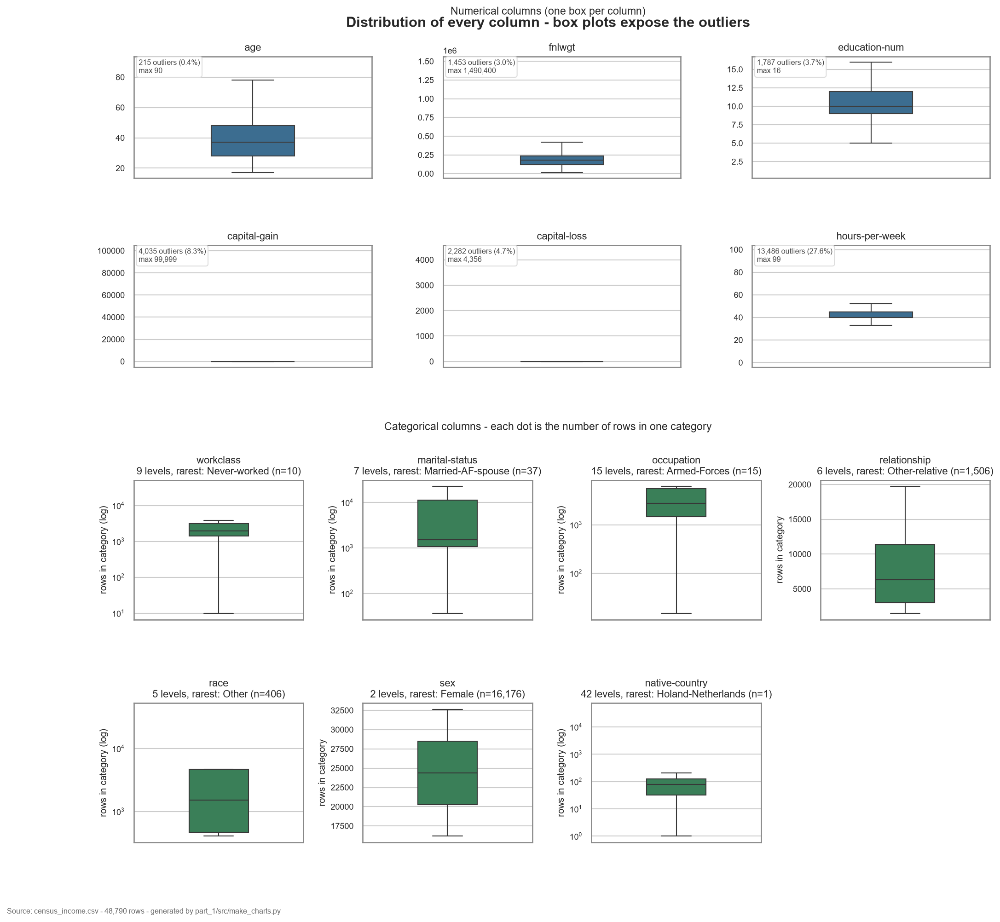
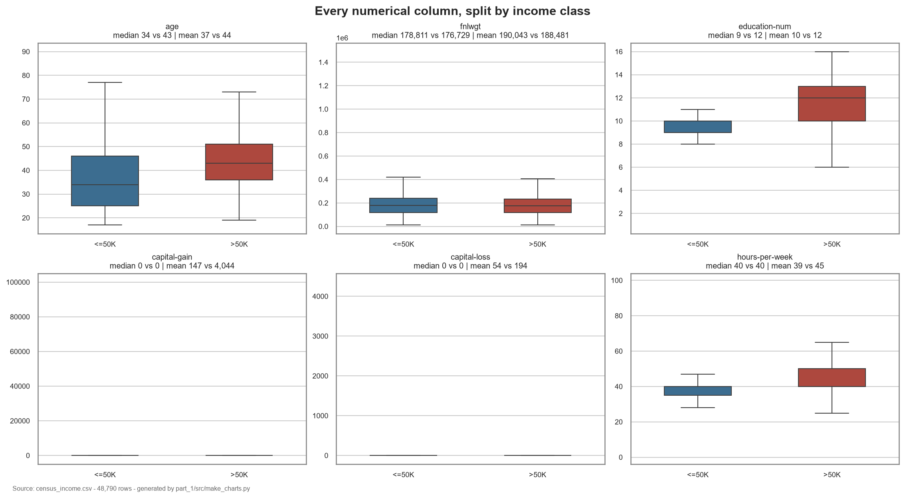
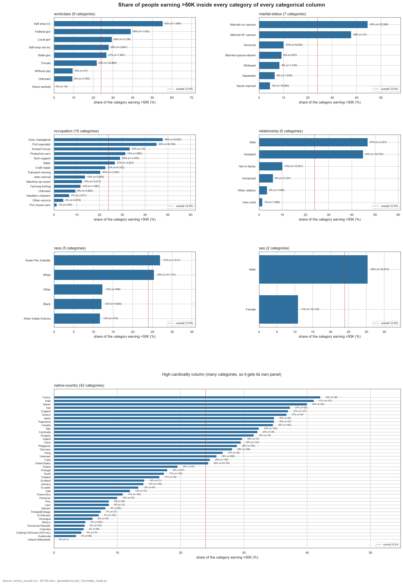
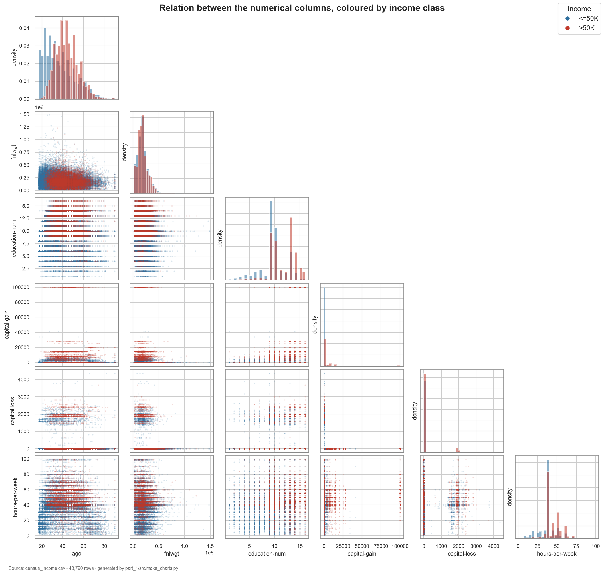

# Task 1 report: Exploratory data analysis

| Field | Value |
| --- | --- |
| Student | Alessandro Jacopo Ravizza |
| Dataset | Census Income (`part_1_task1/data/raw_data/census_income.csv`) |
| Task | 1 |
| Tag / commit | `92ce2f3` (`task1` tag not pushed yet) |
| How to run | `uv sync` then `uv run python part_1_task1/src/build_dataset.py`, `uv run python part_1_task1/src/make_charts.py`, `uv run pytest part_1_task1/tests -q` |
| Timebox | 2:30–3:00, finished |

## 1. Summary

From a 48,842 × 15 raw Census Income file I built a reproducible scikit-learn pipeline that cleans, de-duplicates and encodes the data into one 48,790 × 93 table, plus four seaborn figures that follow my chart design. The target is imbalanced: 23.9% of rows earn more than 50K. `education-num` and `age` separate the classes most (median 9 vs 12 years, 34 vs 43 years old), while `fnlwgt` carries no signal (r = −0.006). The pipeline fixes five data issues, including missing values stored as `" ?"` and four spellings of the label, and 19 tests protect those fixes. The main limitation is imputation: 3,615 rows (7.4%) with a missing field are filled with the literal `"Unknown"`, which mixes refusal, not-applicable and unrecorded answers into one category.

**Evidence:** `part_1_task1/src/build_dataset.py` (`abd4ab1`); the run prints 48,790 × 93 and 0 missing cells.

## 2. Goal and success criteria

**Goal.** Load the dataset reproducibly, describe it statistically, find and fix data issues, and present findings with charts that each support a claim. Success means a fresh clone reproduces every number in this report with the commands above.

| Criterion | How it is measured | Target | Result |
| --- | --- | --- | --- |
| Reproducible load and transform | `build_dataset.py` reads only the raw file | one command rebuilds the table | 48,790 × 93, 0 missing cells |
| Data issues identified and fixed | audit table printed by the script, plus tests | every issue traced to a fix | 5 issues fixed |
| Findings backed by charts | one figure per node of `designs/Charts.jpg` | all nodes covered | 4/4 nodes (1 explicitly N/A) |
| Automated checks | `pytest part_1_task1/tests -q` | all green | 19 passed |

**Evidence:** terminal output of the three commands at the top of this report.

## 3. Approach and key decisions

| # | Finding | Decision | Alternative considered | Where in the code |
| --- | --- | --- | --- | --- |
| D1 | Every header except `age` starts with a space, and every string cell is padded | Read with `skipinitialspace=True`, then strip names and values | Rename the 15 columns by hand | `load_raw`, `clean_text` |
| D2 | Missing values are written as `" ?"`, not as empty cells, so `isna()` sees nothing | Normalise `?`, blank, `N/A`, `None`, `Unknown` to NaN, then fill `"Unknown"` | Drop the 3,615 affected rows (loses 7.4%, and missingness may itself signal income) | `clean_text`, `build_preprocessor` |
| D3 | The label has four spellings (`<=50K`, `<=50K.`, `>50K`, `>50K.`) because train and test splits were pasted together | Strip the trailing dot and map to 0/1; raise on any unknown label | Treat the four strings as four classes | `normalise_target` |
| D4 | 52 rows are exact duplicates once the label spelling is fixed | Drop them | Keep them, because identical rows can be different people | `prepare` |
| D5 | `education` and `education-num` are 1:1 (0 exceptions in 48,842 rows) | Drop `education`, keep the numeric code | One-hot `education` and drop `education-num` | `DROPPED_COLS` |
| D6 | The sketch's numeric list omits `age` and `education-num`, the two strongest numeric signals (r = 0.230 and 0.333) | Add both to the numeric branch; documented deviation from the drawing | Follow the sketch literally and lose both signals | `NUMERIC_COLS` |
| D7 | Numeric columns contain no missing values, so the designed median imputer never fires on this file | Keep the branch, so the pipeline is safe for future data and matches the design | Remove the branch | `build_preprocessor` |
| D8 | Categories have no natural order (e.g. `workclass`, `marital-status`) | One-hot encode | Label/ordinal encoding, which would invent an order | `OneHotEncoder` |
| D9 | The design ends with a single final frame, not two tables | `ColumnTransformer` with pandas output and plain column names, then concat the target | Join two separate DataFrames by hand | `build_preprocessor`, `build_final_frame` |
| D10 | Task 1 only describes the data; no model exists yet | Fit and transform the whole cleaned set, no train/test split | 80/20 split, deferred to Task 3 where a model can use it | `build_dataset.main` |
| D11 | Charts must show `Private` and `United-States`, not 86 dummy columns | Chart the cleaned frame before encoding (`load_analysis_frame`) | Chart the encoded 93-column table | `load_analysis_frame` |
| D12 | The sketch routes categorical columns into box plots to expose outliers | Box plot of the *category counts*; log axis where counts span ≥100× | Count bar charts (easier to read, not what the sketch says) | `plot_distribution` |

```
raw CSV (48,842 x 15)
   |  strip text, fix label spelling, drop duplicates, drop education
   v
48,790 rows x 14 columns + target
   |-- numeric (6) ------> median impute ------------------|
   '-- categorical (7) --> fill "Unknown" --> one-hot -----|
                                                           v
                             unify --> 48,790 x 93 --> census_income_final.csv
```

**Evidence:** `part_1_task1/src/census_pipeline.py`, `part_1_task1/src/build_dataset.py`; commit `abd4ab1`.

## 4. Results

| Result | Value | Baseline or reference |
| --- | --- | --- |
| Raw shape | 48,842 rows × 15 columns | source file |
| Rows after de-duplication | 48,790 | −52 duplicates |
| Unified table | 48,790 × 93 | 6 numeric + 86 one-hot + target |
| Rows with a missing categorical field | 3,615 (7.4%) | filled as `"Unknown"` |
| Class balance | 76.1% ≤50K / 23.9% >50K | no baseline: describes the sample |
| Correlation with the target | education-num 0.333, age 0.230, hours-per-week 0.228, capital-gain 0.223, capital-loss 0.148, fnlwgt −0.006 | Pearson, numeric columns only |
| Median education-num | 9 vs 12 years (≤50K vs >50K) | +33% relative shift |
| Median age | 34 vs 43 years | +26% relative shift |
| High-earner share, married-civ-spouse | 44.6% (n = 22,366) | overall 23.9% |
| High-earner share, never-married | 4.6% (n = 16,082) | overall 23.9% |
| High-earner share, male vs female | 30.4% vs 10.9% | 66.8% of rows are male |
| Zero values in capital-gain / capital-loss | 91.7% / 95.3% of rows | means 147 vs 4,044 and 54 vs 194 |
| Outliers in hours-per-week | 27.6% (13,486 rows), 137 rows at 99 h | 1.5 × IQR rule |

### 4.1 Distribution of every column



**Figure 1.** Box plots expose outliers: 91.7% of `capital-gain` and 95.3% of `capital-loss` rows are zero, `hours-per-week` has 27.6% outliers (137 rows at 99 hours), and the rarest categorical level is `native-country = Holand-Netherlands` with 1 row. Categorical panels use a log axis where the counts span more than 100×, otherwise the rare levels would be invisible next to `United-States` (43,782 rows).

### 4.2 Numerical columns against the target



**Figure 2.** `education-num` shifts most between classes (median 9 → 12 years, +33%), then `age` (34 → 43, +26%). `fnlwgt` moves by only −1.2%, so the sampling weight is not a behavioural signal. `capital-gain` and `capital-loss` keep a median of 0 in both classes, but their means differ by 27× and 3.6×, so the tail — not the typical row — carries the signal.

### 4.3 Categorical columns against the target



**Figure 3.** `marital-status` separates the classes most: `Married-civ-spouse` reaches 44.6% high earners (n = 22,366) against 4.6% for `Never-married`. `sex` shows 30.4% for male rows vs 10.9% for female rows. Thin categories make the native-country bars unreliable (France 42.1% on n = 38), so every bar carries its `n`.

### 4.4 Relations between the numerical columns



**Figure 4.** `age` and `education-num` are the only columns whose point clouds separate the two classes cleanly. `capital-gain` sits on a hard cap at 99,999, and `capital-loss` on round bands — artefacts of how the variables were recorded, not behaviour. `fnlwgt` shows no structure against the target.

**Evidence:** `part_1_task1/src/make_charts.py` (`92ce2f3`), PNGs in `reports/figures/`; every number above is printed by `build_dataset.py` or by the caption output of `make_charts.py`.

## 5. Problems and how you handled them

| Problem | Cause | What I did | Status |
| --- | --- | --- | --- |
| scikit-learn did not treat missing cells as missing | pandas 3 keeps `pd.NA` when a string column is cast to `object` | Convert with `to_numpy(dtype=object, na_value=np.nan)` so the imputer sees `NaN` | Solved |
| `sns.pairplot` mislaid the diagonal panels | seaborn 0.13.2 with pandas 3.1 | Replaced it with a hand-built lower-triangle grid, shared x axis per column | Solved |
| `to_csv(sep=", ")` failed in a test | pandas 3 requires a one-character delimiter | The test writes the fake CSV line by line | Solved |
| Deprecation warning on every box plot | seaborn 0.13.2 still passes the removed `vert=` argument to matplotlib 3.11 | None: it is upstream and harmless | Open |
| `native-country` contains truncated labels `Hong` (30 rows) and `South` (115 rows) | source file truncated Hong Kong / South Korea | Left as separate categories and noted | Open |

**Evidence:** `part_1_task1/tests/` (19 passed); the warning text appears in the pytest summary.

## 6. Limitations and trade-offs

| Area | Limitation or trade-off | Impact | Mitigation or next step |
| --- | --- | --- | --- |
| data | `"Unknown"` mixes refusal, not-applicable and unrecorded answers | 7.4% of rows carry one ambiguous category; any effect of missingness is flattened | Compare a model with and without the `Unknown` indicator in Task 3 |
| data | Dropping duplicates assumes identical rows are the same person | 52 rows removed; adult records can legitimately collide | Documented; impact is 0.1% of rows |
| data | 42 country levels, one with a single row, and truncated labels | One-hot adds 42 sparse columns and unstable percentages | Group countries with n < 100 into `Other` before modelling |
| analysis | No train/test split and no model | No generalisation estimate; every statistic describes this sample only | Stratified split and a baseline classifier in Task 3 |
| analysis | Pearson correlation only captures linear relations | Non-linear effects of age and capital gains are understated | Compare group rates (Figure 3) rather than rely on r alone |
| features | `fnlwgt` is a sampling weight, not behaviour | Noise column with r = −0.006 | Likely drop before modelling |
| fairness | `sex`, `race` and `marital-status` are strongly predictive and retained | A model using them would reproduce historical inequality | Fairness analysis and an explicit decision in Task 3 |
| operations | Figures are derived artefacts and `part_1_task1/data/processed/` is gitignored | Regeneration needs the script and the raw file | A tracked copy lives in `reports/figures/` |

**Evidence:** `part_1_task1/src/build_dataset.py`; `.gitignore`; section 4 figures.

## 7. Next steps

| Priority | Next step | Why | Effort |
| --- | --- | --- | --- |
| 1 | Build the interactive exploration app and containerise it | Task 2 deliverable | M |
| 2 | Add a stratified 80/20 split and a baseline classifier | Turns the findings into a measurable model | M |
| 3 | Group rare categories and drop `fnlwgt` | Reduces 42 sparse dummies and a noise column | S |
| 4 | Decide how `sex`, `race` and `marital-status` may be used | Avoids encoding historical bias without discussion | S |
| 5 | Revisit the imputation strategy with a missingness indicator | Recovers the information lost in `"Unknown"` | S |

**Evidence:** section 6; the open items in section 5.

## 8. Use of AI assistants

| Tool | What you used it for | Where (files or sections) | How you checked the output |
| --- | --- | --- | --- |
| OpenCode agent (DeepSeek V4.1 Flash) | Implement the preprocessing pipeline from `designs/EDA.jpg` and draft the tests | `part_1_task1/src/census_pipeline.py`, `part_1_task1/src/build_dataset.py`, `part_1_task1/tests/` | Ran the script and the tests, compared the audit numbers against the raw file |
| OpenCode agent | Implement the chart design from `designs/Charts.jpg` in seaborn | `part_1_task1/src/make_charts.py`, `reports/figures/` | Opened every PNG, checked that each number in the captions matched the data |
| OpenCode agent | Draft this report from the measured results | `reports/task1.md` | Re-read, corrected and rephrased by me before tagging |
| OpenCode agent | Keep `AI_LOG.md` up to date | `AI_LOG.md` | Reviewed each row |

The assistant misled me once: its first caption for Figure 2 said the largest median shift was `fnlwgt` and then that `fnlwgt` barely moves — a contradiction I only caught by checking the number against the figure.

**Evidence:** `AI_LOG.md`.

## Checklist

- [ ] Task tag pushed and named in the table at the top
- [x] Runs from a fresh clone with the commands above
- [x] No secrets, API keys or large data files committed
- [x] Every section has an Evidence line
- [x] Every figure has a caption with a number
- [x] Guidance blocks and placeholders removed
- [x] `AI_LOG.md` up to date
